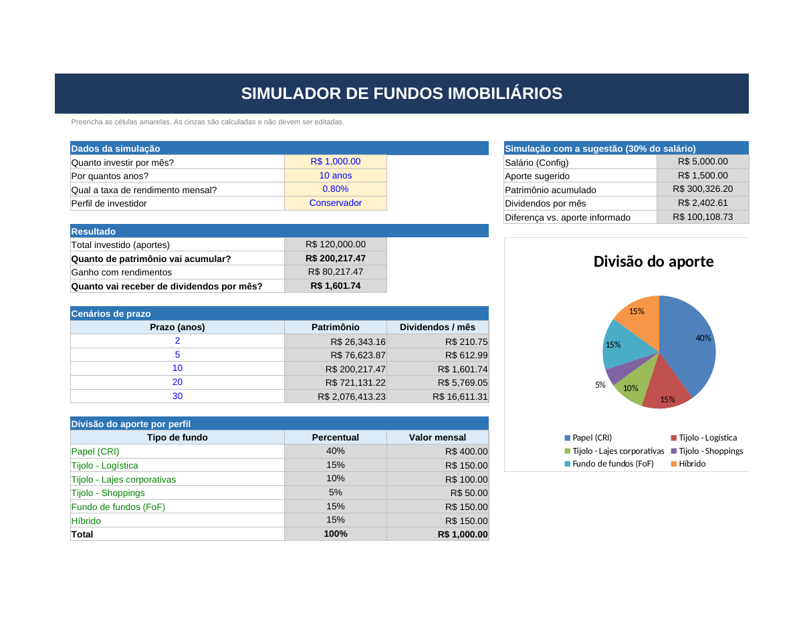
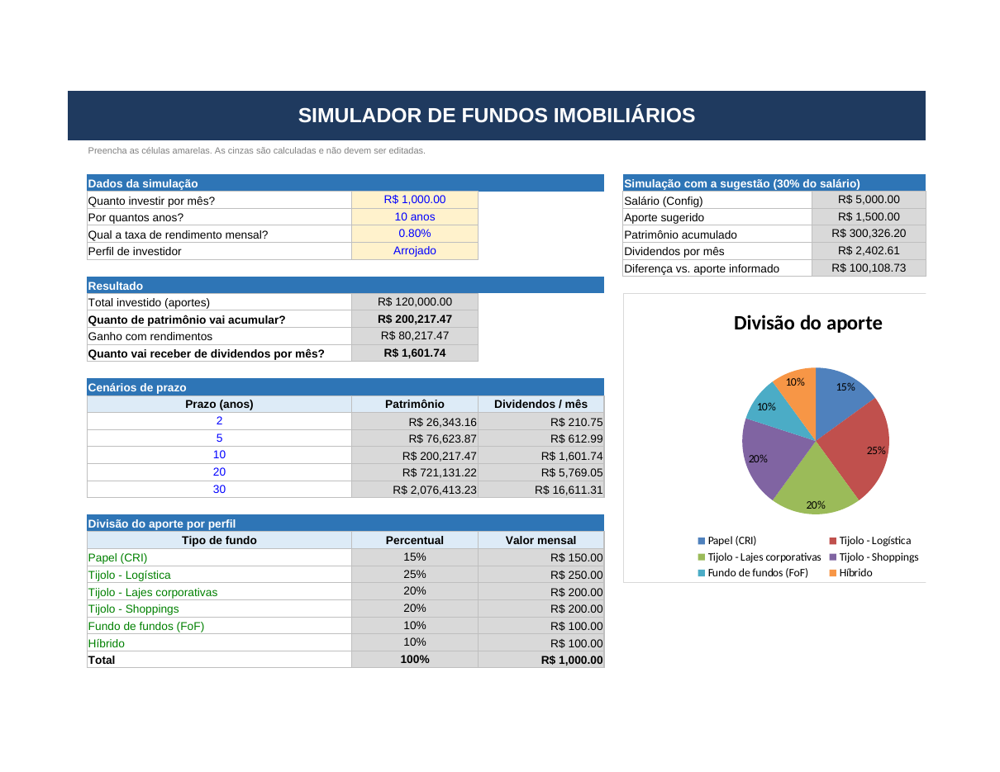

# Simulador de Fundos Imobiliários no Excel

Ferramenta em Excel, com cara de aplicativo, que simula investimentos mensais em fundos imobiliários (FIIs): do aporte de cada mês ao patrimônio acumulado e aos dividendos que ele rende. Projeto feito para o desafio da DIO com o Expert Felipe Aguiar (Felipão).

📥 **Arquivo:** [`simulador-fii.xlsx`](simulador-fii.xlsx)

> Todos os valores (salário, aporte, taxa) são **de exemplo**. Os percentuais por perfil também são ilustrativos e **não são recomendação de investimento**.

## Prints: mesma simulação em dois perfis

Aporte de R$ 1.000/mês, 10 anos, 0,80% a.m. Só o perfil muda, e com ele a divisão do aporte e o gráfico.

| Conservador | Arrojado |
|---|---|
|  |  |

## As 5 perguntas e onde cada resposta aparece (aba `Simulador`)

| Pergunta | Célula | Tipo |
|---|---|---|
| Quanto investir por mês? | `D7` (`aporte`) | entrada (amarela) |
| Por quantos anos? | `D8` (`anos`) | entrada (amarela) |
| Qual a taxa de rendimento mensal? | `D9` (`taxa_mensal`) | entrada (amarela) |
| Quanto de patrimônio vai acumular? | `D14` (`patrimonio`) | calculada (cinza) |
| Quanto vai receber de dividendos por mês? | `D16` (`dividendos`) | calculada (cinza) |

Também mostra: total investido (`D13`), ganho com rendimentos (`D15`), cenários de 2 a 30 anos (`C20:E24`) e a divisão do aporte entre seis tipos de FII (`C28:E34`).

**Convenção visual:** amarelo = pode editar · cinza = calculado, não mexer · texto azul = valor digitado · verde = vem de outra aba. Linhas de grade e títulos de linha/coluna escondidos.

## Como o VF e o PROCV entram nos cálculos

### VF (valor futuro)

```
Patrimônio = VF(taxa_mensal; anos*12; -aporte)
Dividendos = patrimonio * taxa_mensal
```

- `taxa` → `taxa_mensal`: rendimento de cada mês.
- `nper` → `anos*12`: o prazo vira número de meses, porque a taxa é mensal.
- `pgto` → `-aporte`: negativo porque é dinheiro **saindo** do bolso; assim o VF devolve o patrimônio positivo.
- `vp` e `tipo` ficam vazios (começa do zero, aporte no fim do mês).

Os dividendos mensais são o patrimônio final rendendo a mesma taxa mensal.

**Cenários (2, 5, 10, 20 e 30 anos):** a mesma fórmula, trocando o prazo pela célula da coluna de anos: `=VF(taxa_mensal; C20*12; -aporte)`. Como `taxa_mensal` e `aporte` são intervalos nomeados (referências absolutas), a fórmula pode ser arrastada sem "se perder".

### PROCV com chave composta

Na aba `Apoio` há a tabela `tab_perfil` com as colunas **Chave | Perfil | Tipo de fundo | Percentual**. A chave é a junção de perfil e tipo:

```
Chave = D2 & E2        →  "ModeradoPapel (CRI)"
```

No `Simulador`, cada linha da divisão monta a mesma chave e busca o percentual:

```
=PROCV(perfil & C28; tab_perfil; 4; FALSO)
Valor mensal = aporte * D28
```

Um PROCV comum só procura por **um** critério. Como o mesmo tipo de fundo aparece em três perfis, a chave composta deixa cada linha única e o PROCV encontra o percentual certo. O perfil é escolhido numa lista suspensa (validação de dados apontando para `lista_perfis`).

## Intervalos nomeados

| Nome | Onde fica | Para quê |
|---|---|---|
| `aporte` | `Simulador!D7` | aporte mensal |
| `anos` | `Simulador!D8` | prazo em anos |
| `taxa_mensal` | `Simulador!D9` | rendimento mensal |
| `perfil` | `Simulador!D10` | perfil escolhido na lista |
| `total_investido` | `Simulador!D13` | soma dos aportes |
| `patrimonio` | `Simulador!D14` | resultado do VF |
| `dividendos` | `Simulador!D16` | dividendos mensais |
| `salario` | `Config!C4` | salário de exemplo |
| `pct_sugestao` | `Config!C5` | % do salário sugerido (30%) |
| `sugestao_aporte` | `Config!C6` | `salario * pct_sugestao` |
| `lista_perfis` | `Apoio!A2:A4` | origem da lista suspensa |
| `tab_perfil` | `Apoio!C2:F19` | tabela do PROCV |

## Percentuais de cada perfil

| Tipo de fundo | Conservador | Moderado | Arrojado |
|---|---|---|---|
| Papel (CRI) | 40% | 25% | 15% |
| Tijolo – Logística | 15% | 20% | 25% |
| Tijolo – Lajes corporativas | 10% | 15% | 20% |
| Tijolo – Shoppings | 5% | 15% | 20% |
| Fundo de fundos (FoF) | 15% | 15% | 10% |
| Híbrido | 15% | 10% | 10% |
| **Total** | **100%** | **100%** | **100%** |

**De onde vieram:** são percentuais próprios, de exemplo, montados com uma lógica simples. O conservador pesa mais em fundos de papel (renda atrelada a juros e inflação, menos ligada a vacância) e em fundos diversificados (FoF e híbridos). O arrojado pesa mais em fundos de tijolo (logística, lajes e shoppings), mais expostos ao ciclo do mercado imobiliário. **Não são recomendação de investimento.** A aba `Apoio` tem uma conferência (`SOMASE`) que mostra a soma de cada perfil; todas dão 100%.

## O que mudei em relação à ferramenta do Expert

- **Gráfico de pizza** da divisão do aporte, que muda junto com o perfil.
- **Segunda simulação** usando a sugestão de 30% do salário no lugar do aporte informado, com a diferença de patrimônio entre as duas.
- **Total investido** e **ganho com rendimentos**, para mostrar quanto do patrimônio é juros compostos.
- **Conferência automática** de que cada perfil soma 100%.
- A **taxa mensal** fica na tela principal (e não só nas configurações), já que é uma das cinco perguntas.
- Banner próprio e legenda de cores; títulos de linha/coluna escondidos na tela principal.

## Estrutura do arquivo

- **Simulador**: a tela que o usuário usa.
- **Config**: salário e % de sugestão de aporte.
- **Apoio**: lista de perfis, tipos de fundo e a tabela perfil × tipo × percentual.

## Ferramentas

Microsoft Excel (funções VF, PROCV, SOMASE, SOMA; validação de dados; intervalos nomeados; gráfico de pizza).
